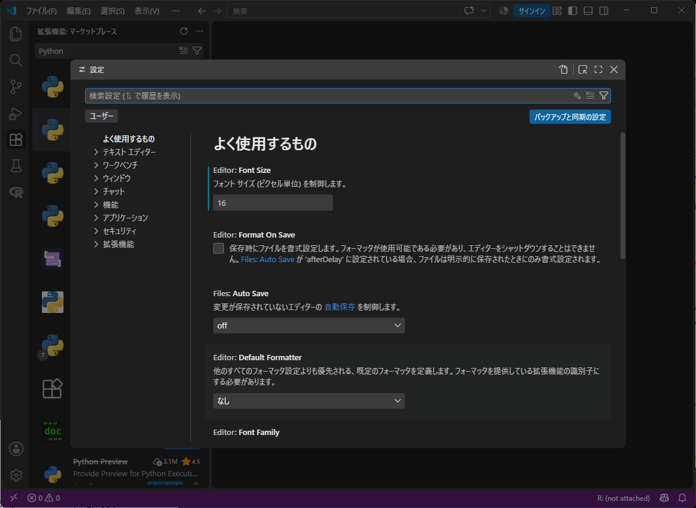
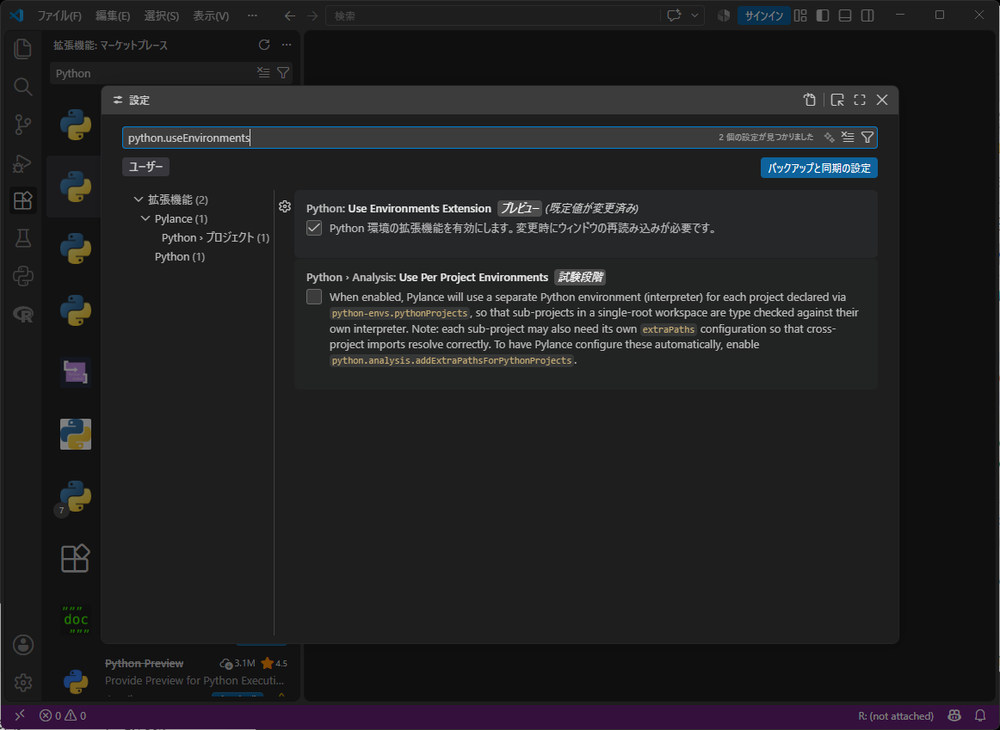
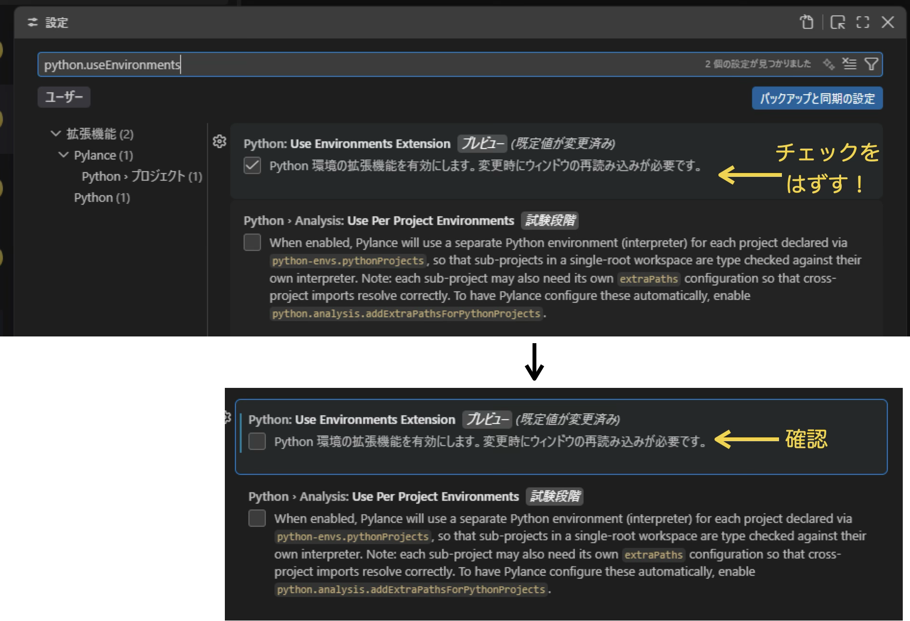
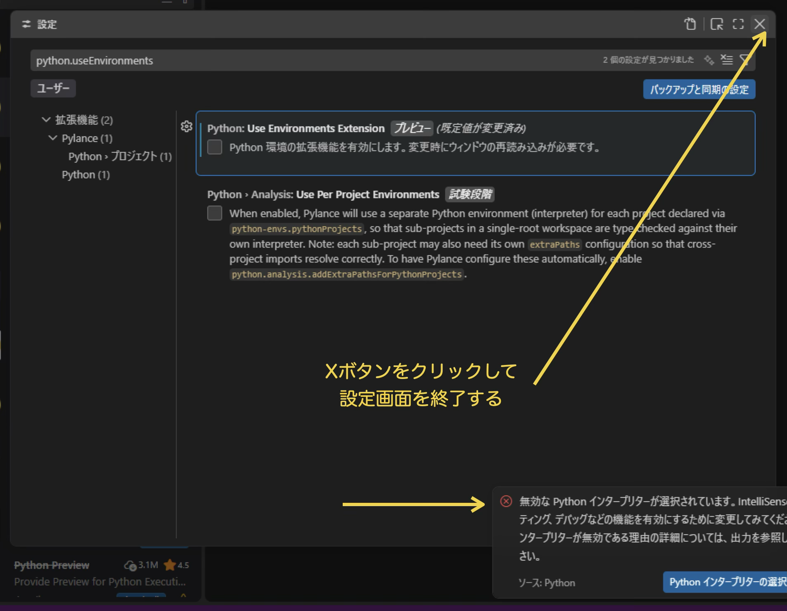

# はじめに

このオンデマンド教材では、「プログラミングとアルゴリズム」の授業を進めていくにあたってのパソコンの環境整備を完成させます。

## 最初の確認

「プログラミング基礎」や「多変量解析」の授業で使ったはずの「**RStudio**」はインストールされていますか？
この設定文書では、RStudioがインストールされていることを前提とします。

```{figure} images/rstudio.png
:width: 60%
RStudioに、のちほどこの授業で使うRのパッケージを追加インストールしていきます。
```

念のため、Consoleに表示されるRのバージョンを確認してください。`4.5.X` (Xは数字)ならOK。上の起動画面では、R.4.5.1がインストールされているので、OKです。もし`4.4.3`など**古い**バージョンならば、アップデートしてください(分からなかったら教員に連絡。)

```{admonition} これからやること

オンデマンド作業は以下のステップで進めていきます。**順番厳守で**作業を行なって下さい。慎重に作業しても30分以内に全部終了するはずです。

1. 授業専用フォルダを作る
  * ACEからダウンロードした教材とデータは、最初に「ダウンロード」フォルダに保存されます。これらは全て、授業専用フォルダの中に移動してください。
2. VSCodeを入れる
  * プログラミングエディタVSCodeをインストールします。
  * 快適に使うための初期設定を行います。
3. RStudioで動くRを、VSCodeから使えるようにする。
3. Python環境を入れる
  * Miniforge（ミニフォージ)というインストーラーを使って、Python環境をインストールします。
4. RとPythonプログラムの動作確認テスト
```

以下、Windowsの人は「**Windowsでの設定**」、Macの人は「**Macでの設定**」に進んでください。

# Windowsでの設定

## 授業専用フォルダの設定

この授業では、教材やデータをたくさん配布します。これらを格納するための**専用フォルダ**を、みなさんのPCに作成してください。

**専用フォルダ**はどこに作ってもらっても構いません。

```{figure} images/win_create_DSfolder.png
:width: 80%
授業専用フォルダを作成する
```

上図では、デスクトップに「`DS`」(`D`ata `S`cienceの頭文字。名前はなんでもよいです)という名前のフォルダを作成しています。これからの授業で配布する教材、データ、講義資料(PDF)は全てこのフォルダの中に保存してください。

--- 

## VSCodeのインストール

既に他の授業でVSCodeをインストールした人は、この節をスキップしても構いません。次の節にあるVSCode拡張のインストールに進んでください。

[https://code.visualstudio.com/download](https://code.visualstudio.com/download)をクリックして、VSCodeのインストールページに飛びます。

```{figure} images/win_vscode_download0.png
:width: 60%
VSCode (Visual Studio Code)のダウンロードページ
```

Windowsのリンクをクリックして、インストーラーをダウンロードしてください。

```{figure} images/win_vscode_download1.png
:width: 60%
```

Windowsのダウンロードフォルダを開いて、`VSCodeUserSetup-x64-XXXXX.exe`という名前のインストーラをダブルクリックし、インストールを開始します。

```{figure} images/win_vscode_download2.png
:width: 60%
ダウンロードフォルダの中にあるインストーラーを見つけて、ダブルクリック。
```

### インストール・ステップバイステップ

```{figure} images/win_install0.png
:width: 60%
「同意する」をチェックして、[次]へ。
```

```{figure} images/win_install1.png
:width: 60%
インストールパスは変更せず、[次]へ。
```

```{figure} images/win_install2.png
:width: 60%
何も変更せず、[次]へ。
```

**次に出現する「追加タスク」は注意**が必要です。「その他」にある**4つのオプション**全てにチェック✅を入れてください。

```{figure} images/win_install3.png
:width: 60%
「その他」に全てチェックを入れる！
```

インストールが始まります。少々お待ちください。。。

```{figure} images/win_install4.png
:width: 60%
「その他」に全てチェックを入れる！
```

次の画面が出たら、VSCodeのインストールはおしまいです。

```{figure} images/win_install5.png
:width: 60%
インストール終了画面。最初の作業はおしまい。
```

[完了]をクリックすると、**VSCodeが自動的に起動します。**

```{figure} images/win_vscode_startup1.png
:width: 100%
VSCodeの最初の起動画面
```

## VSCode拡張のインストール

インストールしたてのVSCodeは、すべてが英語環境になっていて少し使いづらいです。また、授業教材を使うための追加設定も必要です。VSCodeは日本語でデータ分析が容易に使えるような拡張機能が提供されています。ここでは、
以下の2つの拡張機能を追加していきます。

* Japanese Language Pack：日本語表示
* Jupyter：Jupyter Notebook (教材フォーマット)を使うための設定

### 拡張機能ペインを開く

拡張はVSCode左側に出現する「Primaryサイドバー」からインストールします。サイドバーを出すために、VSCode右上にある4つの小さなアイコンのうち、左から2番目にあるアイコンをクリックしてください。

```{figure} images/toggle_toolbar.png
:width: 100%
黄色の矢印のアイコンをクリック。"Toggle Primary Side Bar"というポップアップが目印
```

--- 

### Japanese Language Packのインストール

Primary サイドバーから、(1)左端にある拡張機能ボタンをクリックし、(2)`Extensions: Marketplace`という入力欄に`Japanese`と入力すると、(3) 拡張機能のトップに「Japanese Languae Pack」というのが出てきます（地球儀のアイコンが目印）。右下にある「Install」をクリックしてインストールを開始します。

```{figure} images/JL_install.png
:width: 100%
黄色の文字を順番に操作。Japanese Language Pack for Visual Studio Codeをインストールする。
```

インストールが完了しても、すぐには日本語表示にはなりません。VSCodeウィンドウ右下にある
`Change Language and Restart`というボタンをクリックしてください。

```{figure} images/JL_install2.png
:width: 100%
日本語環境をONにするには、VSCodeを再起動する必要があります。
```

再起動後、**VSCodeが日本語表記に変更されます**。おめでとうございます。

* 留学生の人は、日本語環境ではなく英語表示のままでも構いませんし、Chinese/Korean language packもどこかにあるはずなので、母国語表示も可能と思います。

--- 

### Jupyter拡張のインストール

この授業の教材は「Jupyter ノートブック」というフォーマットで配布されます。Google Colabノートブックを使ったことがあるならば、まさにそれがJupyterノートブックフォーマットです。このフォーマットをVSCodeで使うために、Jupyter拡張をインストールします。

Japanese Language Packをインストールした**拡張機能:マーケットプレース**に、`jupyter`と入力します。すると拡張機能リストのトップに「`Jupyter`」が出現するので、右下の[インストール]をクリックして、拡張機能をインストールします。

```{figure} images/Jupyter_install1.png
:width: 100%
`jupyter`と入力して、TOPでヒットした「Jupyter」をインストールする。
```

この`Jupyter`拡張は、4つの追加的な拡張もまとめてインストールします。

```{figure} images/Jupyter_install1.png
:width: 100%
```

インストールが完了すると、以下の拡張がインストールされているはずです。
* Jupyter 
* Jupyter Keymap
* Jupyter Slide Show
* Jupyter Cell Tags
* Jupyter Notebook Renderers

```{figure} images/Jupyter_install3.png
:width: 100%
Jupyter拡張でインストールされた1+4=5パッケージ群
```

### Python拡張のインストール
拡張機能の検索入力欄に、`Python`と入力してヒットした**Python**を同様にインストールしてください。

```{figure} images/vscode_ext_python.png
:width: 100%
インストールが終わったあとの状態。Python関連パッケージも一緒にインストールされる。
```

```{caution} Python拡張の設定(必須)
2026年10月現在、Windows版VSCodeのPython拡張には小さな不具合があり、Pythonでグラフを表示するとVSCodeがクラッシュする現象が報告されています。次の設定を実行して、この不具合を回避するようにします。

1. VSCodeで、「Ctrl」キーを押しながら`,`を押します。
2. VSCodeの設定ウィンドウが起動します。</img>
3. **検索設定**に、次のように入力してください。

   `python.useEnvironments`

4. すると、画面が少し変化して、下のようになります。</img>
5. 下図に従って、チェックを1箇所外して下さい。</img>
6. 以上で作業は終了です。下図のように、設定画面の右上にあるXボタンをクリックして、この画面を閉じて下さい。</img>

なお、この作業中に、VSCode画面に「無効なPythonインタープリターが選択されています」のような警告画面が出てくることがありますが、環境設定への影響はないので、無視して大丈夫です。
```

```{admonition} VSCodeの基本設定は終了
次に、VSCodeでPythonとRを使うための設定を行っていきます。
```

## Python環境のインストールと設定

Python環境は、**Miniforge3**(ミニフォージ3)という仮想環境システムをインストールすることで設定します。

### Miniforge3のインストール

https://conda-forge.org/download/ をWebブラウザで開きます。`Windows x86_64`をクリックして、Miniforgeのインストーラーをダウンロードします。

```{figure} images/Mamba_install0.png
:width: 80%
Miniforge3 Installer (Windows用)のダウンロード
```

ダウンロードフォルダに`Miniforge3-Windows-x86_64`というインストーラーが保存されるので、これをダブルクリックして、インストールを開始します。

```{figure} images/Mamba_install1.png
:width: 100%
ダウンロードしたインストーラーをダブルクリックしてインストーラーを起動する
```

```{figure} images/miniforge3_install0.png
:width: 60%
[Next >]をクリックしてインストール開始
```

#### インストール・ステップバイステップ

```{figure} images/miniforge3_install1.png
:width: 60%
[I Agree]をクリック
```

```{figure} images/miniforge3_install2.png
:width: 60%
Just me (recommended)にチェックが入っていることを確認して、[Next >]をクリック
```

**Destination Folder** (インストールするフォルダ)は、`C:¥Users¥(あなたのユーザー名)¥miniforge3`に設定されています。そのままにしておきます。

```{figure} images/miniforge3_install3.png
:width: 80% 
[Next >]をクリック。
```

次の画面では、**1、3、4番目にチェックを入れて(確認して)、[Install]をクリックします**。インストールが始まります。

```{figure} images/miniforge3_install4.png
:width: 40% 
```

インストールが終わるまで、少々お待ちください。

```{figure} images/miniforge3_install5.png
:width: 340
インストール中。。。
```

```{figure} images/miniforge3_install6.png
:width: 340
インストール終了。[Next >]をクリック
```

```{figure} images/miniforge3_install7.png
:width: 340
終了画面。[Finish]をクリックしてインストールを完了する。
```

### 初期設定

インストールが完了したら、VScodeでPythonプログラムを動かすための初期設定を行います。すこし細かい作業なので、慎重に行なって下さい。

デスクトップの検索入力🔍に`miniforge`と入力します。すると、`Miniforge Prompt`というアプリがヒットするので、これをクリックします。

```{figure} images/win_miniforge_prompt.png
:width: 480
Windowsの検索入力に、miniforgeと入力して、miniforge promptをクリックする
```

Miniforge Promptは真っ黒の味気ない画面ですが、ここに次のような**命令**を入力して[ENTER]します。

```
conda init cmd.exe
```
この命令は、インストールしたPythonをVSCodeから使えるようにするために必要です。 **注意**：必ず日本語変換はOFFにして半角英数字の状態でタイプしてください。

```{figure} images/win_miniforge_prompt2.png
命令を入力した画面。[Enter]キーを押して、命令を実行します。
```

すると、命令を実行した結果が次々に出力されます：

```{figure} images/win_miniforge_prompt3.png
```

これは単に眺めているだけでよいです。全部終わると、画面の最終行に

```
(base) C:\Users\(あなたのユーザー名)>
```

と表示されていることを確認します。確認したら、このMiniforge Promptは終了して下さい。

次に、先ほどインストールしたVSCodeで作業します。

1. まず、[ここ](https://www.dropbox.com/scl/fi/7sg4n0sykm62del9a9b29/FDS_Python_setup.yml?rlkey=mks4ryzro0w8d7kkzamk51g1q&dl=1) をクリックして、`FDS_Python_setup.yml`というファイルをダウンロードします。
2. ダウンロードフォルダにある`FDS_Python_setup.yml`を、**専用フォルダ**に移動して下さい。
3. VSCodeで、[ファイル]メニュー→[フォルダを開く]をクリックし、専用フォルダを選択して開いて下さい。下図のように、VSCode画面左側にエクスプローラーという画面があり、そこには専用フォルダの中に`FDS_Python_setup.yml`が見えていれば、OKです。

```{figure} images/vscode_env0.png
:width: 100%
最初に設定した専用フォルダを、VSCodeで開いた状態。
```

4. 次に、下図のように準備します。
  * VSCode画面右上の[サインイン]の右側に並ぶ4つの四角形アイコンのうち、(1)右から2番目をクリック
  * (2)VSCode画面下側に出現した[ターミナル]画面の(3)下向き矢印をクリックして、(4)`Command Prompt`をクリック

```{figure} images/vscode_dsenv_prepare.png
:width: 100%
(1)(2)(3)(4)の手順通りに作業しましょう。
```

5. 出現したコマンドプロンプト(Command Prompt)画面に、次のコマンドを入力して、[ENTER]キーを押します：

```
conda env create -f FDS_Python_setup.yml
```
```{figure} images/vscode_env2.png
:width: 100%
VSCode内のコマンドプロンプトに、コマンドを入力した様子。
```

6. Python環境が作られていきます。下図のような画面になったら終了です。

```{figure} images/vscode_env3.png
:width: 100%
Python環境作成完了！
```

7. ここまで構築したPython環境を、VSCodeの中から使えるように、2つの設定を行います。

現在の、VSCodeターミナルに次のコマンドを入力します。

**コマンド1**
```
conda activate DS 
```

**コマンド2**
```
python -m ipykernel install --user --name ds-python --display-name "Python(DS)"
```

下の図では、コマンド1、コマンド2を順々に実行していった様子が示されています。

```{figure} images/win_python_kernel.png
```

```{note}
コマンド1, 2を入力するのが面倒と感じる場合は、上のコマンドを選択してコピー(**⌘-C**)し、VSCodeターミナル上で貼り付け(ペースト, **⌘-V**)するのがおすすめです。
```

**以上でPython環境のインストールと設定は終了です。**

---

```{admonition} 次のR環境のインストールと設定に行く前に、必ずやってください：
1. いったん**VSCodeを終了します**。終了しないと、次の作業が完了できません。
2. **RStudioを起動して下さい**。既にRStudioが起動している人は、そのままでOKです。
```

---

## R環境のインストールと設定

[ここ](https://www.dropbox.com/scl/fi/hgry3uj5tm6frt3y8n85k/FDS_R_setup.R?rlkey=217f99c6obnqysn3p8xphjecc&dl=1)をクリックして、`FDS_R_setup.R`をダウンロードします。パソコンのダウンロードフォルダに`FDS_R_setup.R`が入っていますので、RStudioで、これを開きます。

1. RStudioの[File]メニューをクリック。
2. [Open File...]をクリック。
3. パソコンのダウンロードフォルダに移動して、`FDS_R_setup.R`を選択し、開く。

下図のように、`FDS_R_setup.R`のプログラムがRStudioに表示されます。

```{figure} images/rstudio_init1.png
:width: 80%
RStudioに、`FDS_R_setup.R`を読み込む
```

プログラムの右上に`Source`というボタンがあるので、クリックして実行します。次のような警告メッセージが表示されたら、[はい(Y)]**ではなく[いいえ(N)]を選択**して下さい。

```{figure} images/rstudio_init2.png
:width: 80%
警告⚠️メッセージがポップアップする→ いいえ(N)をクリック。
```

RStudioがプログラムを実行すると、この授業でデータ分析に必要なライブラリがインストールされていきます。少し時間がかかります。
下図のように、「ダウンロードされたパッケージは、以下にあります」というメッセージが表示されたら、作業終了です。

```{figure} images/rstudio_init3.png
:width: 80%
インストール終了画面
```

インストールが終了したら、RStudioを終了してください。Quit R Sessionという確認メッセージが出たら、`Don't Save`を選択して終了します。
```{figure} images/rstudio_quit.png
:width: 60%
[Don't Save]を選択する。
```

```{admonition} 🎊 以上で全ての設定が終了です。🍾

おつかれさまでした。動作確認に進んでください。

```

---

# Macでの設定

## 授業専用フォルダの設定

この授業では、教材やデータをたくさん配布します。これらを格納するための**専用フォルダ**を、みなさんのMacに作成してください。

**専用フォルダ**はどこに作ってもらっても構いません。

図では、デスクトップに「`DS`」(`D`ata `S`cienceの頭文字。名前はなんでもよいです)という名前のフォルダを作成しています。これからの授業で配布する教材、データ、講義資料(PDF)は全てこのフォルダの中に保存してください。

## VSCodeのインストール

既に他の授業でVSCodeをインストールした人は、この節をスキップしても構いません。次の節にある「VSCode拡張のインストール」に進んでください。

[https://code.visualstudio.com/download](https://code.visualstudio.com/download)をクリックして、VSCodeのインストールページに飛びます。

```{figure} images/win_vscode_download0.png
:width: 60%
VSCode (Visual Studio Code)のダウンロードページ
```

**MacOS**のリンクをクリックして、インストーラーをダウンロードします。下図のように、ダウンロードフォルダに、`VSCode-dawin-XXX.dmg`のようなディスクイメージを見つけたら、これをダブルクリックし、アプリケーションフォルダにドラッグすれば、インストール完了です。

```{figure} images/mac_vscode_install.png
:width: 100%
```

VSCodeは、アプリケーションフォルダの中に入っています。ダブルクリックして起動してください。

```{figure} images/mac_vscode_loc.png
:width: 100%
```

## VSCode拡張のインストール

インストールしたてのVSCodeは、すべてが英語環境になっていて少し使いづらいです。また、授業教材を使うための追加設定も必要です。VSCodeは日本語でデータ分析が容易に使えるような拡張機能が提供されています。ここでは、
以下の2つの拡張機能を追加していきます。

* Japanese Language Pack：日本語表示
* Jupyter：Jupyter Notebook (教材フォーマット)を使うための設定
* Python: Python環境を使う設定

### 拡張機能ペインを開く

拡張はVSCode左側に出現する「Primaryサイドバー」からインストールします。サイドバーを出すために、VSCode右上にある4つの小さなアイコンのうち、左から2番目にあるアイコンをクリックしてください。

```{figure} images/toggle_toolbar.png
:width: 100%
黄色の矢印のアイコンをクリック。"Toggle Primary Side Bar"というポップアップが目印
```

--- 

### Japanese Language Packのインストール

Primary サイドバーから、(1)左端にある拡張機能ボタンをクリックし、(2)`Extensions: Marketplace`という入力欄に`Japanese`と入力すると、(3) 拡張機能のトップに「Japanese Languae Pack」というのが出てきます（地球儀のアイコンが目印）。右下にある「Install」をクリックしてインストールを開始します。

```{figure} images/JL_install.png
:width: 100%
黄色の文字を順番に操作。Japanese Language Pack for Visual Studio Codeをインストールする。
```

インストールが完了しても、すぐには日本語表示にはなりません。VSCodeウィンドウ右下にある
`Change Language and Restart`というボタンをクリックしてください。

```{figure} images/JL_install2.png
:width: 100%
日本語環境をONにするには、VSCodeを再起動する必要があります。
```

再起動後、**VSCodeが日本語表記に変更されます**。おめでとうございます。

* 留学生の人は、日本語環境ではなく英語表示のままでも構いませんし、Chinese/Korean language packもどこかにあるはずなので、母国語表示も可能と思います。

--- 

### Jupyter拡張のインストール

この授業の教材は「Jupyter ノートブック」というフォーマットで配布されます。Google Colabノートブックを使ったことがあるならば、まさにそれがJupyterノートブックフォーマットです。このフォーマットをVSCodeで使うために、Jupyter拡張をインストールします。

Japanese Language Packをインストールした**拡張機能:マーケットプレース**に、`jupyter`と入力します。すると拡張機能リストのトップに「`Jupyter`」が出現するので、右下の[インストール]をクリックして、拡張機能をインストールします。

```{figure} images/Jupyter_install1.png
:width: 100%
`jupyter`と入力して、TOPでヒットした「Jupyter」をインストールする。
```

この`Jupyter`拡張は、4つの追加的な拡張もまとめてインストールします。

```{figure} images/Jupyter_install1.png
:width: 100%
Jupyter機能および関連する4つの追加機能が、まとめてインストールされる。
```

### Python拡張のインストール
拡張機能の検索入力欄に、`Python`と入力してヒットした**Python**を同様にインストールしてください。

```{figure} images/vscode_ext_python.png
:width: 100%
インストールが終わったあとの状態。Python関連パッケージも一緒にインストールされる。
```

```{admonition} VSCodeの基本設定は終了
次に、VSCodeでPythonとRを使うための設定を行っていきます。
```

## Python環境のインストールと設定

Python環境は、**Miniforge3**(ミニフォージ3)という仮想環境システムをインストールすることで設定します。

### Miniforge3のインストール

https://conda-forge.org/download/ をWebブラウザで開きます。`macOS arm64 (Apple Sillicon)`をクリックして、Miniforgeのインストーラーをダウンロードします。

```{figure} images/Mamba_install0.png
:width: 80%
Miniforge3 Installer (Mac用)のダウンロード
```

ダウンロードフォルダに`Miniforge3-Darwin-arm64`というインストーラーが保存されたことを確認してください。

次に、Finderから[移動]→[ユーティリティ]をクリックして、ユーティリティアプリのフォルダを表示します。この中に**ターミナル**または**ターミナル\.app**というアプリを見つけて、起動してください。

```{figure} images/mac_mamba_install0.png
:width: 100%
```

ターミナル画面に、次のコマンドを入力します。
``` bash
cd Downloads
```
さらに、次のコマンドを入力します(半角英数字で入力。大文字小文字は区別されます)。
```bash
bash Miniforge3-Darwin-arm64.sh
```
インストールが始まります。

```{figure} images/mac_mamba_install1.png
:width: 100%
ターミナル.appの画面。コマンドを実行します。
```

#### インストール・ステップバイステップ

ターミナルには英語しか表示されないので、ここはひとつひとつ確認しながら進めていきましょう。

```{figure} images/mac_mamba_install2.png
:width: 80%
"Please, press ENTER to continue"→ [ENTER]キー
```

**ライセンス表示画面**

最初にソフトウエア利用条件が長々と表示されますが、読まずにスペースキーを1回ずつ押していきます。

```{figure} images/mac_mamba_install3.png
:width: 60%
```

```{figure} images/mac_mamba_install4.png
:width: 60%
```

**ライセンス同意画面**

最後に`Do you accept the license terms? [yes|no]`と聞かれるので、`yes`と入力します。

```{figure} images/mac_mamba_install5.png
:width: 60%
```

**インストール先フォルダの指定**

何も入力せずに、[ENTER]キーを押して下さい。
```{figure} images/mac_mamba_install6.png
:width: 60%
```

→ インストールが開始します。パッケージダウンロードが始まり、ターミナル上に大量の文字が出力されます。数分経つと下の画面に切り替わります。

**インストール作業の仕上げ**

ここでは、`yes`と入力して、[ENTER]キーを押します。

```{figure} images/mac_mamba_install7.png
:width: 60%
Proceed with initialization? [yes|no]は、`yes`を選択！
```

最後にインストール完了のメッセージが表示され、入力を要求されなくなります。**これでインストール作業は完了です。**
このことを確認したら、ターミナル.appは終了してください。

### 初期設定

次に、先ほどインストールしたVSCodeで作業します。VSCodeを起動したあと、次の作業を行なって下さい。

1. まず、[ここ](https://www.dropbox.com/scl/fi/7sg4n0sykm62del9a9b29/FDS_Python_setup.yml?rlkey=mks4ryzro0w8d7kkzamk51g1q&dl=1) をクリックして、`FDS_Python_setup.yml`というファイルをダウンロードします。
2. ダウンロードフォルダにある`FDS_Python_setup.yml`を、**専用フォルダ**に移動して下さい。
3. VSCodeで、[ファイル]メニュー→[フォルダを開く]をクリックし、専用フォルダを選択して開いて下さい。下図のように、VSCode画面左側にエクスプローラーという画面があり、そこには専用フォルダの中に`FDS_Python_setup.yml`が見えていれば、OKです。

```{figure} images/mac_python_create_dsenv.png
:width: 100%
専用フォルダに`FDS_Python_setup.yml`を保存し、VSCodeターミナルを起動して、コマンドを入力する。
```

この状態で、上図(2)(3)の作業を行います。

* VSCode右上にある「VSCodeターミナル」を表示するアイコンをクリック
* VSCodeターミナルで、次のコマンドを入力して[ENTER]。

```
conda env create -f FDS_Python_setup.yml
```

4. インストール開始

授業で使うPythonライブラリが**追加で**インストールされます。

```{figure} images/mac_python_dsenv_installing.png
:width: 60%
追加インストール作業は数分かかります。
```

終了すると、VSCodeターミナルは下のような画面になります。

```{figure} images/mac_python_dsenv_finish.png
:width: 80%
インストール終了。
```


6. ここまで構築したPython環境を、VSCodeの中から使えるように、2つの設定を行います。

現在の、VSCodeターミナルに次のコマンドを入力します。

**コマンド1**
```
conda activate DS 
```

**コマンド2**
```
python -m ipykernel install --user --name ds-python --display-name "Python(DS)"
```

下の図では、コマンド1、コマンド2を順々に実行していった様子が示されています。

```{figure} images/mac_python_dsenv_kernel.png
```

```{note}
コマンド1, 2を入力するのが面倒と感じる場合は、上のコマンドを選択してコピー(**⌘-C**)し、VSCodeターミナル上で貼り付け(ペースト, **⌘-V**)するのがおすすめです。
```


**以上でPython環境のインストールと設定は終了です。**

```{admonition} 次のR環境のインストールと設定に行く前に、必ずやってください：
1. いったん**VSCodeを終了します**。終了しないと、次の作業が完了できません。
2. **RStudioを起動して下さい**。既にRStudioが起動している人は、そのままでOKです。
```

---

## R環境のインストールと設定

[ここ](https://www.dropbox.com/scl/fi/pqtmuozjmj29sddg9qy9m/FDS_R_setup_mac.R?rlkey=a5txjb5j40m7c3mo7mxxn7y7q&dl=1)をクリックして、`FDS_R_setup_mac.R`をダウンロードします。Macのダウンロードフォルダに`FDS_R_setup_mac.R`が入っていますので、RStudioで、これを開きます。

1. RStudioの[File]メニューをクリック。
2. [Open File...]をクリック。
3. パソコンのダウンロードフォルダに移動して、`FDS_R_setup_mac.R`を選択し、開く。

下図のように、`FDS_R_setup_mac.R`のプログラムがRStudioに表示されます。

```{figure} images/rstudio_init1.png
:width: 80%
RStudioに、`FDS_R_setup_mac.R`を読み込む
```

プログラムの右上に`Source`というボタンがあるので、クリックして実行します。次のような警告メッセージが表示されたら、[はい(Y)]**ではなく[いいえ(N)]を選択**して下さい。

```{figure} images/rstudio_init2.png
:width: 80%
警告⚠️メッセージがポップアップする→ いいえ(N)をクリック。
```

RStudioがプログラムを実行すると、この授業でデータ分析に必要なライブラリがインストールされていきます。少し時間がかかります。
下図のように、「ダウンロードされたパッケージは、以下にあります」というメッセージが表示されたら、作業終了です。

```{figure} images/rstudio_init3.png
:width: 80%
インストール終了画面
```

インストールが終了したら、RStudioを終了してください。Quit R Sessionという確認メッセージが出たら、`Don't Save`を選択して終了します。
```{figure} images/rstudio_quit.png
:width: 60%
[Don't Save]を選択する。
```

```{admonition} 🎊 以上で全ての設定が終了です。🍾

おつかれさまでした。動作確認に進んでください。

```

# 動作確認

以降ではWindows版VSCodeを中心に説明していきますが、Mac版VSCodeでも(外見は少し違うけど)同一のステップで確認することができます。

## 動作確認用教材ノートブックのダウンロード

* [OD1_python.ipynb](https://www.dropbox.com/scl/fi/ndoqebrbfbme9n575el8b/OD1_python.ipynb?rlkey=ubflx11oioi4citvkbl8o66js&dl=1)

* [OD1_R.ipynb](https://www.dropbox.com/scl/fi/9xzra4dj3agrp7p9ir7q6/OD1_R.ipynb?rlkey=v0dsskz3vim5kz6748ijc068j&dl=1)

ダウンロードしたこれら2つのファイルを、**専用フォルダ**に移動(保存)して下さい。

```{figure}images/confirm0.png
ダウンロードした動作確認ファイル(2つ)を、専用フォルダに移動する。
```

VSCodeを開いて、「ファイル」メニューから「フォルダーを開く」で、専用フォルダを開いて下さい。

```{figure}images/confirm1.png
専用フォルダをVSCodeで開いた状態
```

## Pythonの動作確認

まずは、(1)`OD1_python.ipynb`というPython文書の内容をクリックして表示します。これは「**Jupyter Notebook**」と呼ばれる世界標準のフォーマットで作られています。

```{figure}images/confirm_python.png
動作確認プログラム(Python)を実行する準備
```

VSCodeの中で、私たちの書いたプログラムを実行するアプリを、「**カーネル(kernel)**」と呼びます。Pythonプログラムを実行するカーネルは、これまでの作業で「**DS (Python)**」という名前のカーネルで登録しました。上図(3)の部分に注目してください。ここでDS(Python)というカーネルを選択することで、Pythonプログラムを実行することができます。

下図のようにプログラムの左側にある▶️アイコンをクリックすると、プログラムが実行されます。

```{figure}images/confirm_python_result.png

```

折れ線と、図のタイトルが文字化けせずに表示されたら、動作確認終了です。このファイルはもう使わないので閉じてしまって問題ありません。そのためには、次の手順を踏みます。

1. ファイル名のタブ(画面上部)の「⚪︎」マークにカーソルを合わせると、「×」に変わります。
2. 「×」をクリックします。すると「保存して終了」するかどうか聞かれるので、保存して終了します。


## Rの動作確認

Rプログラムを実行するカーネルは、これまでの作業で「**R(DS)**」という名前で登録してきました。Python動作確認と同様、下図の手順でR(DS)カーネルを準備してください。

```{figure}images/confirm_R.png

```

下図のようにプログラムの左側にある▶️アイコンをクリックすると、プログラムが実行されます。

```{figure}images/confirm_R_result.png

```

ヒストグラムが表示されれば、動作確認完了です。
