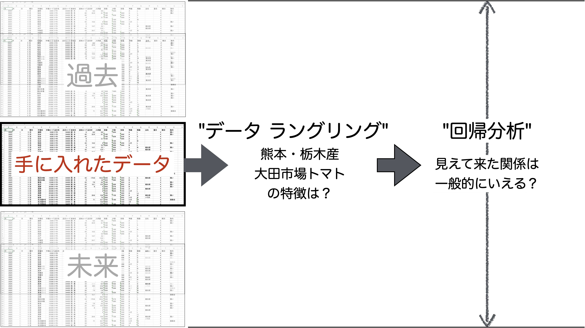
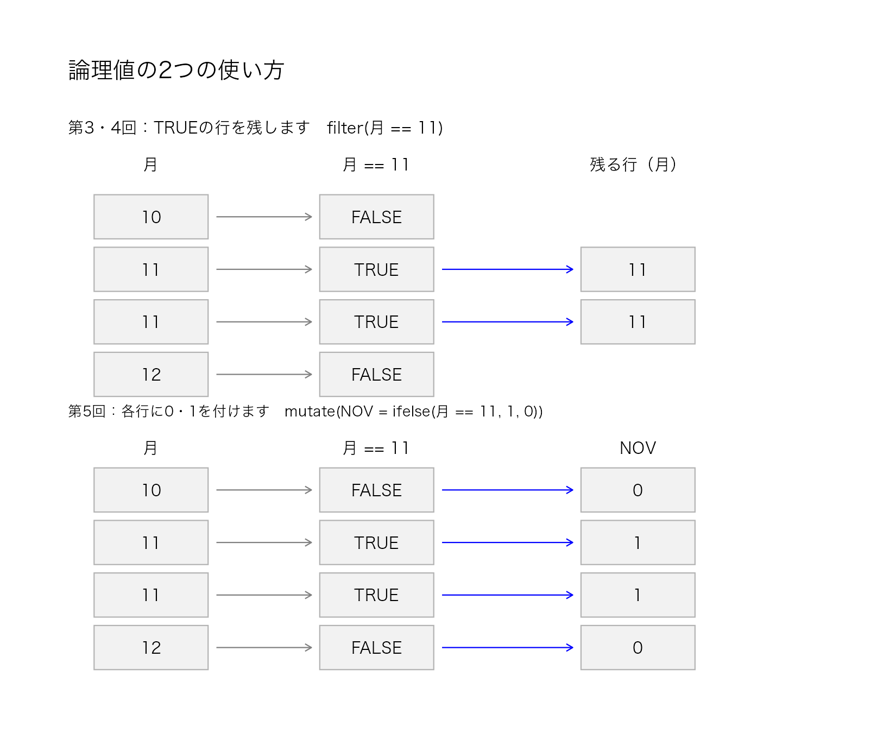
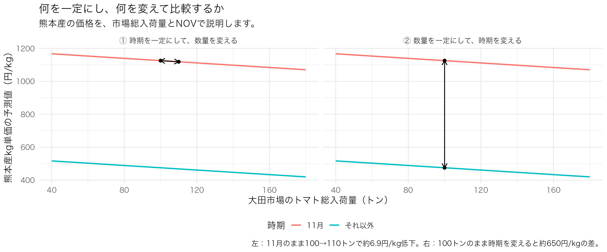
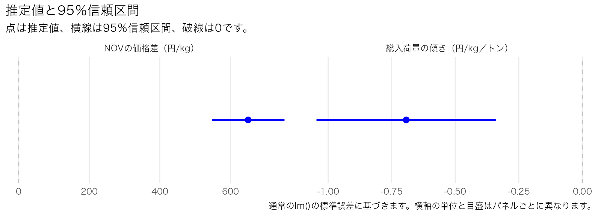

# 第5回　Rによる回帰分析：熊本産トマトの高値を、市場の入荷量と時期から読み解く

## はじめに：授業開始時の準備

「第5回」フォルダに`5_R_Regression.ipynb`と`tomato.xlsx`を保存し、VS Codeでこのフォルダを開きます。カーネルはR(DS)を選びます。

本編は第0〜7節です。上から順に実行し、A1〜A8の演習セルには自分でコードを書きます。R1〜R5は授業後の復習です。A演習は前の結果を使います。難しい場合は折りたたんだ解答例で補ってから次に進みます。

```r
getwd()
file.exists("tomato.xlsx")
```

`TRUE`なら準備完了です。`FALSE`なら、ExcelファイルをNotebookと同じフォルダに置いたか確認してください。

## 導入：数量と価格を、誰が気にしているのでしょうか

第3・4回ではデータを整え、Split-Apply-Combineによる集計や、`ggplot`を使った図で、
トマト卸売価格の特徴を調べました。今回は、卸売市場(大田市場)に出入りする関係業者の関心から、**数量と価格の関係**を式で表す**回帰分析**に進みます。


| 立場 | 気になること |
|---|---|
| 産地(生産者) | 「たくさん出荷できても、値下がりしたら売上はどうなるだろう？」 |
| 小売(スーパーなどから買い付けに来る) | 「必要な量を仕入れたい。仕入れ値が高いと、売価や仕入れる量をどうしよう？」 |
| 仲卸 | 「取引先(小売)が求める品質と数量を、販売できる価格で産地から確保できるだろうか？」 |

**考えてみよう：トマトの価格が上がったとき、それぞれの立場で何が気になりますか？**

例えば、私たちがトマトの大産地のひとつ熊本県の業者だとします。大田市場には、熊本産以外にも栃木県などからトマトが入荷してきます。
卸売業者は、これらを集荷し、適切な価格で大田市場にやってくるスーパー・デパートからの小売業者に販売します。

もし、小売業者からの需要が(ほぼ)一定とみなせるならば、ミクロ経済学で扱われる需要と供給の法則により、以下のことが成り立つことが理論的に予想されます：

```{admonition} 数量と価格の理論的関係からいえること
* 集荷量が多いとき、大田市場のトマトの価格は安くなる傾向にあります。
* 集荷量が少ないとき、大田市場のトマトの価格は高くなる傾向にあります。
```

前回の授業で、大田市場でのトマト価格は11月に高くなる傾向が観察されました。

```{admonition} 今日の問題設定
11月の熊本産トマトは、なぜ高かったのでしょうか。市場の総入荷量が少なかったことだけで説明できるでしょうか。
上で述べた理論的関係を、データから精確に確認してみましょう。
```



## 0．準備：熊本産価格と大田市場全体の数量を組み合わせたデータを作成する。

| 項目 | 使うデータ |
|---|---|
| 年・市場・品目 | 2025年・大田市場・トマト |
| 価格 | 熊本産、量目4kgの中値を4で割ったkg単価（円/kg） |
| 数量 | 大田市場にその日に入荷した全産地のトマト**総入荷量**。|

`入荷量`列は産地別の数量、`品目計`列は市場全体の数量です。今回は品目計を使い、分かりやすく`総入荷量`という列名にします。

### 分析用データの作成

まずは次のセルを実行し、授業で使うためのデータの元バージョンを作ります。

```r
# データラングリングで必要なライブラリの読み込み
library(readxl)
library(tidyverse)

## STEP 1：データを読み込む。
tomato_raw <- read_excel("tomato.xlsx", sheet = "トマト", na = c("", "-"))

## STEP 2:大田市場の取引データのみを取り出し、パイプ|>で繋げて、前処理を次々に実行する
ota <- tomato_raw |>
  filter(年 == 2025, 市場名 == "大田", 品目名 == "トマト") |>
  mutate( 
    日付 = make_date(year = 年, month = 月, day = 日),
    産地名 = str_remove_all(産地名, "[[:space:]　]"), 
    中値 = as.numeric(中値),                          
    kg単価 = 中値 / 量目                              
  ) |>
  group_by(日付) |>                                     
  fill(品目計, .direction = "downup") |>
  ungroup()

## STEP 3：
analysis_data <- ota |>
  filter(産地名 == "熊本", 量目 == 4,
         !is.na(kg単価), kg単価 > 0,
         !is.na(品目計), 品目計 > 0) |>
  mutate(総入荷量 = 品目計) |>
  select(日付, 月, 産地名, kg単価, 総入荷量) |>
  arrange(日付)

nrow(analysis_data)
analysis_data |> count(月)
```

130日・130記録です。価格は熊本産、数量は市場全体という対応を確認してください。

**演習セル：演習A1（自分の分析用の大田市場トマトデータを作る）**

`select()`、`nrow()`、`head()`を使って、以下のプログラムを作成してください。

1. `analysis_data`から日付・月・kg単価・総入荷量を選び、`my_data`に保存する。
2. 行数と先頭6行を確認しましょう。

授業では、`analysis_data`は説明用、`my_data`は皆さんの演習用の表です。

```r
# 演習セル：演習A1：自分の分析用の表を作る
# ここに自分のコードを書いて実行してください。
```

<details>
<summary>解答例（自分で試してから開く）</summary>

```r
my_data <- analysis_data |>
  select(日付, 月, kg単価, 総入荷量)
nrow(my_data)
head(my_data)
```

130行・4列です。以降の演習ではmy_dataを使います。

</details>

### 作図の準備：提供コード

日本語フォントを設定します。これはそのまま実行してください。

```r
font_candidates <- c("Noto Sans CJK JP", "Noto Sans JP", "IPAexGothic",
                     "IPAGothic", "Hiragino Sans", "Meiryo", "Yu Gothic")
available_fonts <- unique(systemfonts::system_fonts()$family)
jp_font <- font_candidates[font_candidates %in% available_fonts][1]
if (is.na(jp_font)) jp_font <- "sans"
theme_set(theme_gray(base_family = jp_font))
options(repr.plot.width = 9, repr.plot.height = 5.5)
```

## 1．単回帰：数量と価格の関係を式で表す

**市場総入荷量が異なる日の、熊本産価格を比較します。**

市場に入るトマトが多い日と少ない日では、価格はどれくらい違うのでしょうか。FDSや企業のマーケティングなどで行う回帰分析では、
できるだけ単純な「**回帰モデル**」というものを作って、これを把握しようとします。

ここでは、数量と価格の関係を、2つの変数の一次関数(直線)で把握します。このような回帰モデルを**単純回帰モデル**または**単回帰モデル**と呼びます。

```text
kg単価(データ) = 定数項 ＋ 係数 × 総入荷量(データ) ＋ 誤差
```

**定数項**は、一次関数の切片です。**係数**は一次関数の傾きです。

現実には価格と数量が上のような「ぴったり」と一次関数の関係で表されることは**あり得ません**。価格(kg単価)の動きは、総入荷量以外の要因に影響をうけることもあるからです。そのような要因を「**誤差**」と呼び、定数項・総入荷量に足し合わせることで、左辺の価格と等しくしています。

誤差なんていうものを、あえて導入する理由は何でしょうか？

現場の人たちは、ミクロ経済学の理論や市場の経験から、価格(kg単価)の動きは入荷量の動きと**逆に動く**ことを理解していますが、それ以外の日々の不確定要素でも動くことを知っています。不確定要素は天候だったり、消費者の一時的な需要の浮き沈みだったりとさまざまなものがあり、市場関係者といえども事前にすべて想定することは不可能です。

この理由から、最初から不確定要素を"誤差"として扱い、これを踏まえた上で価格と入荷量の関係を調べるようにするというのが、単回帰モデルの基本的なアイディアです。

総入荷量と定数項のみで計算できる"価格"を、総入荷量を用いた価格の**予測値**と呼びます。**単回帰モデルは、予測値を総入荷量の一次関数で求めていきます**。

## データから定数項と係数を求める：最小二乗法(`lm()`)

データから係数を求めることを**推定**といいます。`lm()`は、実際の価格と直線の予測値のずれを二乗して合計し、その合計を最小にする係数を求めます。これが**最小二乗法**です。

Rでは、次のようなステップで実行します。

###  モデルの指定

価格を予測する一次関数モデル：

```text
kg単価 = 定数項 + 係数×総入荷量
```

をRで指定するには、`~`(チルダ記号)を使った"**式(formula)オブジェクト**"を記述します。

* `~`の左に被説明変数
* `~`の右に説明変数

として、次のように記述します。

```R
kg単価 ~ 総入荷量
```

データを使ってこれから求める定数項・係数は記述しません。変数だけ記述するのがポイントです。

この式オブジェクトを、Rの線形回帰分析用関数`lm()`の最初の引数に指定し、2番目の引数に`data=データフレームオブジェクト`を指定することで、回帰分析が実行されます。私たちのデータを使うと、以下のようにプログラムを記述できます：

```r
lm(kg単価 ~ 総入荷量, data = analysis_data)
```

`lm`を実行すると、回帰分析に関する様々な結果がひとまとめになった**lmオブジェクト**が作られます。ここには多くの情報が詰め込まれているので、通常は変数に代入し、その後に実行結果の詳細情報にアクセスします。

次の例では、`fit_simple`には推定結果が保存されます。`coef()`で係数を取り出します。`(Intercept)`が定数項です。
```r
fit_simple <- lm(kg単価 ~ 総入荷量, data = analysis_data)
coef(fit_simple)
```
この回帰分析の結果から、大田市場の熊本産トマトの価格(kg単価)の予測値は、次のように表されることが分かります。

```text
kg単価の予測値 = 672.663 − 1.256 × 総入荷量
```

大田市場への総入荷量が10トン多いと、熊本産の予測価格は約12.6円/kg低くなる直線です。

**演習セル：演習A2（単回帰を自分で推定する）**

みなさんが上で作った`my_data`で同じ単回帰を推定して`my_simple`に保存し、係数を表示してください(上と同じ結果が得られます)。

```r
# 演習セル：演習A2：単回帰を自分で推定する
# ここに自分のコードを書いて実行してください。
```

<details>
<summary>解答例（自分で試してから開く）</summary>

```r
my_simple <- lm(kg単価 ~ 総入荷量, data = my_data)
coef(my_simple)
```

総入荷量の係数は約−1.256です。

</details>

## 2．散布図と直線：総入荷量と実際の価格/予測値を比べる(ggplot2)

**各日の価格(データ)と、その日の総入荷量に対する予測値(回帰モデルの推定結果)を比較します。** 

ここでは、`ggplot()`の最も単純な実行方法を覚えましょう。

1. `ggplot(aes(x = ..., y = ...))`で横軸と縦軸を指定
2. `geom_point()`で点、`geom_line()`で線を描く

```r
analysis_data |>
  ggplot(aes(x = 総入荷量, y = kg単価)) +
  geom_point()
```

**演習セル：演習A3（散布図を描く）**

**授業中**

my_dataで、横軸を総入荷量、縦軸をkg単価にした散布図を描いてください。

```r
# 演習セル：演習A3：散布図を描く
# ここに自分のコードを書いて実行してください。
```

<details>
<summary>解答例（自分で試してから開く）</summary>

```r
my_data |>
  ggplot(aes(x = 総入荷量, y = kg単価)) +
  geom_point()
```
</details>

各点は、ある取引日における熊本産のトマトを表しています。

### 予測値を表に追加して、直線を重ねる

既に計算済みのlmオブジェクトを使って、回帰分析の結果を上の散布図に重ねて描画します。

* `predict(lmオブジェクト)`(プレディクト)は、推定した式に各行の総入荷量を入れ、予測値を一つずつ返します。
  * 予測値は、将来だけでなく、手元の各記録についても計算できます。
* 単回帰モデルの誤差項＝不確定要素を実際のデータで求めたものを、**残差**と呼びます。
```text
残差 = 実際のkg単価 − kg単価の予測値
```
* `resid(lmオブジェクト)`(レジッド)は、残差を計算する関数です。

以下のプログラムでは、lmオブジェクト`fit_simple`の予測値を、`analysis_data`の総入荷量を使って計算し、実際のkg単価とのズレ＝残差も計算しています。

```r
analysis_data <- analysis_data |>
  mutate(予測kg単価 = predict(fit_simple, newdata = analysis_data),
         残差 = kg単価 - 予測kg単価)
```

`analysis_data`に追加された`予測kg単価`の動きを、散布図に追加します：

```r
analysis_data |>
  ggplot(aes(x = 総入荷量, y = kg単価)) +
  geom_point() +
  geom_line(aes(y = 予測kg単価), colour = "blue")
```

点と線の縦の差が残差です。線より上の点は正、下の点は負です。**高価格の点は、どの時期の記録でしょうか。観察してみましょう**

**演習セル：演習A4（予測値を列にする）**

my_simpleの予測値を`単回帰予測値`としてmy_dataに追加し、kg単価・総入荷量・単回帰予測値の先頭6行を表示してください。

```r
# 演習セル：演習A4：予測値を列にする
# ここに自分のコードを書いて実行してください。
```

<details>
<summary>解答例（自分で試してから開く）</summary>

```r
my_data <- my_data |>
  mutate(単回帰予測値 = predict(my_simple, newdata = my_data))
my_data |> select(kg単価, 総入荷量, 単回帰予測値) |> head()
```

</details>

```{admonition} `lm`オブジェクトの重要な関数
* `coef(lmオブジェクト)`：回帰分析で推定された定数項と係数の推定値を、ベクターで得る
* `predict(lmオブジェクト, newdata=...)`：`newdata`にある説明変数の値から、回帰モデルの予測値を得る
* `resid(lmオブジェクト)`：回帰分析で推定された誤差項の推定値＝残差を、ベクターで得る
```


```{note}
単回帰(一次関数)モデルで得られたkg単価の予測値と、実際のkg単価の外れ具合(残差)は、どうやら総入荷量が小さいときに上方向に大きいことが観察できます。残差は、モデルで表せない、現時点で不確定要素とみなしている価格への要因です。いったいこのはずれ具合は何なのかが、気になります。
```

## 3．散布図を月で色分けする

前回のデータラングリングで、トマトの価格は11月に非常に高いことが観察できました。このとき、数量はどうなっているのでしょうか？

**同程度の総入荷量でも、月によって価格の分布が違うかを比較します。** `factor(月)`は月を計算する数ではなく、色分けするグループとして扱う指定です。

```r
analysis_data |>
  ggplot(aes(x = 総入荷量, y = kg単価, colour = factor(月))) +
  geom_point()
```

散布図を、横軸から上方向に眺めてみます。同じくらいの総入荷量(横軸)のとき、価格(縦軸)のばらつきはどうなっているでしょうか？特定の月だけ、他の月よりも際立って高くなっているように見えないでしょうか？

**演習セル：演習R1（月ごとに色分けする）**

**復習**

A3の散布図を、月ごとに色分けしてください。

```r
# 演習セル：演習R1：月ごとに色分けする
# ここに自分のコードを書いて実行してください。
```

<details>
<summary>解答例（自分で試してから開く）</summary>

```r
my_data |>
  ggplot(aes(x = 総入荷量, y = kg単価, colour = factor(月))) +
  geom_point()
```
</details>

```{note}
どうやら、総入荷量が小さいときに残差が上方向に大きい理由として、2025年11月に大田市場の価格に何かが起こったのだろうという見当がつきます。

ネットで2025年11月のトマトの価格に起こったことを少し調べてみると、8月に熊本県に発生した豪雨災害でトマトの生育が壊滅的に悪くなったことが分かります。

参考：https://news.ntv.co.jp/n/kkt/category/economy/kk156cb5f22c734bb99e1b8b1825b89024

よって、熊本県産トマトは、11月の出荷時期に十分な数量を出荷できなかったことが価格高騰の要因であると考えることができます。

この時点で、価格変動に影響を与える不確定要素のうち「豪雨災害の影響」という11月固有の事情が"確定要素"として明らかになりました。回帰分析では、このような要因を考慮して定式化する必要が出てきます。
```

### ダミー変数NOVを作る

11月に高価格の点が多く見られることを考慮するために、回帰分析では、「**ダミー変数**」という人工的な変数データを作成することが一般的です。

ここでは、元の表データにある出荷月の値から、「**11月を1、それ以外を0とするダミー変数NOV**」(NOVemberの略)を作ってみます。

ダミー変数は、論理値と`ifelse`という関数を使って作ることができます。

* まず、論理値を考えます。
  * `月 == 11`は、元の表データにある変数「月」のベクターの各要素を11と比べ、11に等しいならば`TRUE`、そうでないなら`FALSE`を返します。
* 次に、`ifelse(月==11, 1, 0)`で、`TRUE/FALSE`を`0`・`1`に変えます。
* 最後に、この結果を`mutate()`で列に追加します。出来上がったのが、ダミー変数`NOV`です。

データラングリングでは、`filter()`を使って、論理値が`TRUE`になる行を選び出しました。ダミー変数では、`TRUE`/`FALSE`を`1`/`0`の値に対応づけた、新しいデータを作成します。



```r
analysis_data <- analysis_data |>
  mutate(NOV = ifelse(月 == 11, 1, 0),
         時期 = ifelse(NOV == 1, "11月", "それ以外")) # ついでに時期という変数も作っておく
analysis_data |> count(NOV, 時期)
```

11月は9記録、それ以外は121記録です。時期は図の凡例に使う名前です。

**演習セル：演習A5（NOVを作る）**

**授業中**

my_dataにNOVを追加し、0・1の記録数を確認してください。

```r
# 演習セル：演習A5：NOVを作る
# ここに自分のコードを書いて実行してください。
```

<details>
<summary>解答例（自分で試してから開く）</summary>

```r
my_data <- my_data |>
  mutate(NOV = ifelse(月 == 11, 1, 0))
my_data |> count(NOV)
```

NOV＝0は121行、NOV＝1は9行です。

</details>

**演習セル：演習R2（別の月を調べる）**

**データラングリングの復習**

10月の記録を取り出し、記録数と平均kg単価を求めてください。

```r
# 演習セル：演習R2：別の月を調べる
# ここに自分のコードを書いて実行してください。
```

<details>
<summary>解答例（自分で試してから開く）</summary>

```r
my_data |>
  filter(月 == 10) |>
  summarise(記録数 = n(), 平均kg単価 = mean(kg単価))
```

10月は6記録です。

</details>

## 4．集計：11月とそれ以外の違いを確認する

**二つの時期の平均kg単価と平均総入荷量を比較します。** 第3・4回のグループ別集計で、散布図の特徴を数値で確認します。

```r
nov_summary <- analysis_data |>
  group_by(NOV) |>
  summarise(記録数 = n(), 平均kg単価 = mean(kg単価),
            平均総入荷量 = mean(総入荷量), .groups = "drop")
nov_summary
```

| 時期 | 記録数 | 平均kg単価（円/kg） | 平均総入荷量（トン） |
|---|---:|---:|---:|
| それ以外 | 121 | 約438.7 | 約152.7 |
| 11月 | 9 | 1,140.0 | 約79.0 |

11月は平均価格が2.5倍ほど高く、平均総入荷量は50%ほど少なくなっています。

**演習セル：演習A6（グループ平均を保存する）**

**授業中**

my_dataをNOVでグループ化し、記録数・平均kg単価・平均総入荷量を求めて`my_summary`に保存してください。

```r
# 演習セル：演習A6：グループ平均を保存する
# ここに自分のコードを書いて実行してください。
```

<details>
<summary>解答例（自分で試してから開く）</summary>

```r
my_summary <- my_data |>
  group_by(NOV) |>
  summarise(記録数 = n(), 平均kg単価 = mean(kg単価),
            平均総入荷量 = mean(総入荷量), .groups = "drop")
my_summary
```
</details>

**演習セル：演習R3（平均の位置を描く）**

**復習**

my_summaryの平均総入荷量を横軸、平均kg単価を縦軸にして、NOV別に色分けした2点を描いてください。

```r
# 演習セル：演習R3：平均の位置を描く
# ここに自分のコードを書いて実行してください。
```

<details>
<summary>解答例（自分で試してから開く）</summary>

```r
my_summary |>
  ggplot(aes(x = 平均総入荷量, y = 平均kg単価, colour = factor(NOV))) +
  geom_point()
```

</details>

```r
analysis_data |>
  ggplot(aes(x = 総入荷量, y = kg単価)) +
  geom_point(aes(colour = 時期)) +
  geom_line(aes(y = 予測kg単価), colour = "black")
```

11月の点が1本の線より大きく上に離れていることが観察できます。次は「11月かどうか」という情報を式に加えます。

**演習セル：演習R4（自分の単回帰の線を重ねる）**

**復習**

my_dataをNOVで色分けし、単回帰予測値の値を`geom_line`を使い、直線で重ねてください。

```r
# 演習セル：演習R4：自分の単回帰の線を重ねる
# ここに自分のコードを書いて実行してください。
```

<details>
<summary>解答例（自分で試してから開く）</summary>

```r
my_data |>
  ggplot(aes(x = 総入荷量, y = kg単価)) +
  geom_point(aes(colour = factor(NOV))) +
  geom_line(aes(y = 単回帰予測値), colour = "gray")
```


</details>

## 5．重回帰モデル：NOVで直線の高さを分ける

単回帰モデルでは、次のような式オブジェクトで価格と数量の関係を求めました：

```r
kg単価 ~ 総入荷量
```

ところが、この式オブジェクトでは、**11月の価格は他の月よりも高い**ことが取り込まれていません。

そこで、右辺の説明変数に、ダミー変数`NOV`を追加して、11月の高価格要因を考慮することにします。説明変数が2つ以上の回帰モデルを「重回帰モデル」と呼びます。式オブジェクトは、次のように説明変数を`+`で追加します。

```r
kg単価 ~ 総入荷量 + NOV
```

このモデルを`lm`関数に与えて、重回帰モデルを求めます：

```r
fit_linear <- lm(kg単価 ~ 総入荷量 + NOV, data = analysis_data)
coef(fit_linear)
```

**演習セル：演習A7（重回帰を自分で推定する）**

**授業中**

my_dataで総入荷量とNOVを使うモデルを推定し、my_linearに保存して係数を表示してください。

```r
# 演習セル：演習A7：重回帰を自分で推定する
# ここに自分のコードを書いて実行してください。
```

<details>
<summary>解答例（自分で試してから開く）</summary>

```r
my_linear <- lm(kg単価 ~ 総入荷量 + NOV, data = my_data)
coef(my_linear)
```

総入荷量の係数は約−0.693、NOVの係数は約650.23です。

</details>

### 考察：ダミー変数を使った予測値の表現方法

以上より、重回帰モデルでの予測値は、次のように表されます。

```text
熊本産kg単価の予測値 = 544.486 − 0.693 × 総入荷量 ＋ 650.226 × NOV
```

この式を理解するためには、ダミー変数が表していることを**具体的に書き出してみる**ことが重要です。

```text
NOV＝0：予測値 = 544.486 − 0.693 × 総入荷量 + 650.226 × 0 =  544.486 − 0.693 × 総入荷量
NOV＝1：予測値 = 544.486 − 0.693 × 総入荷量 + 650.226 × 1 =  1194.711 − 0.693 × 総入荷量
```

すなわち、11月とそれ以外で、**2種類の予測値の式**が作られたことになります。これらは、
傾きが同じ値`-0.693`、切片が`544.486`(11月以外)・`1194.711`(11月)で異なる、**２本の平行な直線**です。

２本の直線を、グラフで可視化してみましょう。まず、重回帰モデルの予測値を、`重回帰予測`という変数名で分析データ`analysis_data`に追加します。
予測値を得る方法は、`predict`関数を使いました。

```r
analysis_data <- analysis_data |>
  mutate(重回帰予測 = predict(fit_linear, newdata = analysis_data))
```

次に、`geom_line`で可視化します。

```r
analysis_data |>
  ggplot(aes(x = 総入荷量, y = kg単価, colour = 時期)) +
  geom_point() +
  geom_line(aes(y = 重回帰予測))
```

**演習セル：演習R5（2本の線を自分で描く）**

**復習**

my_linearの予測値をmy_dataに追加し、NOV別の2本の予測線を描いてください。

```r
# 演習セル：演習R5：2本の線を自分で描く
# ここに自分のコードを書いて実行してください。
```

<details>
<summary>解答例（自分で試してから開く）</summary>

```r
my_data <- my_data |>
  mutate(重回帰予測 = predict(my_linear, newdata = my_data))
my_data |>
  ggplot(aes(x = 総入荷量, y = kg単価, colour = factor(NOV))) +
  geom_point() +
  geom_line(aes(y = 重回帰予測))
```


</details>

### 同じ横位置で、2本の線を比べる

100トンの位置を見ると、それ以外は約500円/kg、11月は約1,100円/kgです。具体的な予測値をコードで確認します。

`tibble()`で条件を並べた表を作ります。`c(100, 100)`と`c(0, 1)`は、各列に入れる2個の値です。

```r
comparison <- tibble(総入荷量 = c(100, 100), NOV = c(0, 1))
comparison <- comparison |>
  mutate(予測kg単価 = predict(fit_linear, newdata = comparison))
comparison
```

予測値は約475円/kgと約1,125円/kgで、差は約650円/kgです。**数量を同じにして時期を比較することが、総入荷量をコントロールした比較です。**

第4節の平均価格の差は約701円/kgで、二つの時期の総入荷量の違いも含んでいます。**総入荷量をそろえて比較すると、価格差は約650円/kgになります。**



| 読む係数 | 一定にするもの | 変えるもの | 予測価格の違い |
|---|---|---|---|
| 総入荷量 | 時期（NOV） | 総入荷量を10トン増やす | 約6.9円/kg低くなる |
| NOV | 総入荷量 | それ以外から11月へ | 約650円/kg高くなる |

図の左は100トンから110トンへの比較で、約6.9円/kgの差です。**どの条件をそろえているか、図を指して説明してください。**

## 6．推定の確かさ：標準誤差・信頼区間・p値

約650円/kgという差が得られました。次に、**この差は、推定の揺れを考えても0と区別できるでしょうか。**データを集め直せば推定値も変わるため、推定の不確かさも読みます。ここで0とは「同じ総入荷量なら、時期による予測価格の差がない」ことです。

ここでは、誤差が互いに独立で、同じ分散の正規分布に従うモデルを使い、通常の`lm()`の推測の読み方を学びます。

### 係数表を開く

```r
summary(fit_linear)
```

`Coefficients:`の表に注目します。

まずNOVの行の`Estimate`（推定値）と`Std. Error`（標準誤差）を読みます。t値とp値は、信頼区間を見た後に確認します。

### 標準誤差：係数の揺れの目安

同じ条件でデータを集め直して推定すると、係数は少しずつ変わります。そのばらつきを手元のデータから見積もったものが標準誤差です。

NOVの推定値は約650.23円/kg、標準誤差は約52.07円/kgです。標準誤差は、価格そのもののばらつきではなく、**価格差の推定の不確かさ**です。

### 95％信頼区間：推定の幅を見る

今回の95％信頼区間は、おおよそ「推定値 ± 標準誤差の2倍」です。推定値の周りに、推定の不確かさに応じた幅を持たせます。正確な区間は`confint()`で計算します。

```r
confint(fit_linear)
```

| 係数 | 推定値 | 標準誤差 | 95％信頼区間 |
|---|---:|---:|---:|
| 総入荷量 | −0.693 | 0.178 | −1.046 ～ −0.340 |
| NOV | 650.226 | 52.066 | 547.197 ～ 753.254 |

NOVの価格差は、約547〜753円/kgという幅で推定されます。95％とは、同じ条件で標本を取り直してこの方法で区間を作ると、その約95％が真の係数を含むという意味です。

図の点が推定値、横線が信頼区間です。今回は両方の区間が0を含みません。区間が0をまたぐ結果なら、傾きや価格差が0という値も区間に含まれ、正か負かを明確に判断できません。



### t値：0からの距離を標準誤差で測る

「NOVの係数は0」、つまり「同じ総入荷量なら、時期による予測価格の差はない」を検証の基準にします。これを**帰無仮説**と呼びます。

```text
t値 = (係数の推定値 − 0) ÷ 標準誤差
```

係数表では`t value`の列です。NOVについて、表示用の概数で計算してみます。

```r
650.226 / 52.066
```

約12.49です。0から標準誤差の約12.49個分離れています。t値の符号は係数と同じです。離れ方は符号を除いた大きさ（絶対値）で読みます。

### p値：係数が0という仮説と照らし合わせる

係数表の`Pr(>|t|)`の列がp値です。

**帰無仮説とモデルの仮定が成り立つとき、今回以上に絶対値の大きいt値が得られる確率がp値です。** 正負の両方向を見るので両側検定と呼びます。

授業では5％（0.05）を有意水準とします。p値が0.05未満なら、係数が0という帰無仮説を棄却し、5％水準で統計的に有意と表現します。0.05以上なら、0と異なると判断する証拠が十分ではありません。p値は、帰無仮説が正しい確率ではありません。

総入荷量のp値は約0.000166、NOVは0.001未満で、両方とも有意です。同じ両側t検定では、95％信頼区間が0を含まないことと、p値が0.05未満であることが対応します。`< 2e-16`は「0.0000000000000002より小さい」という表示です。

**差の大きさは推定値で、不確かさは標準誤差・信頼区間で読み、p値で0との差を検討します。** p値の小ささは、価格差の大きさや実務上の重要さを表しません。

**演習セル：演習A8（係数の意味と確かさを説明する）**

**授業中・目安5分**

1. `summary(my_linear)`と`confint(my_linear)`を実行します。
2. 総入荷量の推定値を標準誤差で割り、t値が約−3.88になることを確かめます。
3. 総入荷量の95％信頼区間は0を含みますか。p値と合わせて、5％水準で有意かを答えます。
4. 時期を一定にして総入荷量が10トン違うときの価格差を、係数の10倍で求め、意味を説明します。

```r
# 演習セル：演習A8：係数の意味と確かさを説明する
# ここに自分のコードを書いて実行してください。
```

<details>
<summary>解答例（自分で試してから開く）</summary>

```r
summary(my_linear)
confint(my_linear)
-0.692648 / 0.178454
-0.692648 * 10
```

t値は約−3.88、95％信頼区間は約−1.046〜−0.340で0を含みません。p値は約0.000166で有意です。同じ時期の区分では、総入荷量が10トン多いと予測価格は約6.9円/kg低くなります。

</details>

## 7．まとめ：業者の関心と今日の問いに戻る

**市場全体の総入荷量だけでは、11月の熊本産トマトの高値を十分に説明できませんでした。**

同じ総入荷量で比べると、11月の予測価格は約650円/kg高くなりました。95％信頼区間は約547〜753円/kg、p値は0.001未満で、このモデルではNOVの係数は5％水準で有意です。

| 作業 | 比較したこと |
|---|---|
| 単回帰 | 市場総入荷量が違う日の熊本産価格を1本の線で表す |
| 色分け・集計 | 11月とそれ以外の価格・総入荷量の違いを見る |
| 重回帰 | 総入荷量と時期で予測する2本の線を見る |
| コントロール | 総入荷量をそろえて時期を比べる／時期をそろえて数量を比べる |
| 信頼区間・p値 | 係数の推定の不確かさと、0との差を検討する |

産地・仲卸・小売が価格を見通すとき、総入荷量は手がかりになります。今回の結果は、**入荷量に加えて時期の違いにも目を向ける必要がある**ことを示しています。

**最後の問い：NOVの係数を、比較した条件・差の大きさ・推定の確かさを含む一文で説明してください。**

A1〜A8をつなげると、表の準備→単回帰→散布図と予測→NOV→集計→重回帰→係数の評価という分析プログラムになります。復習R5では、自分のモデルで2本の線を描けます。

## 本日扱ったR関数・記法

| したいこと | 関数・記法 |
|---|---|
| 行・列を選ぶ、列を追加する | `filter()`、`select()`、`mutate()` |
| グループ別に集計する | `group_by()`、`summarise()`、`n()`、`mean()` |
| 日別の総量を欠損欄に補う（提供コード） | `fill()`、`ungroup()` |
| ダミーを作る・色分けの群を指定する | `ifelse()`、`factor()` |
| モデルを推定し、係数を取り出す | `lm()`、`coef()` |
| 予測する条件の表を作り、予測する | `tibble()`、`predict()` |
| 係数の推測結果・95％信頼区間を読む | `summary()`、`confint()` |
| 散布図・予測線を描く | `ggplot()`、`aes()`、`geom_point()`、`geom_line()` |
